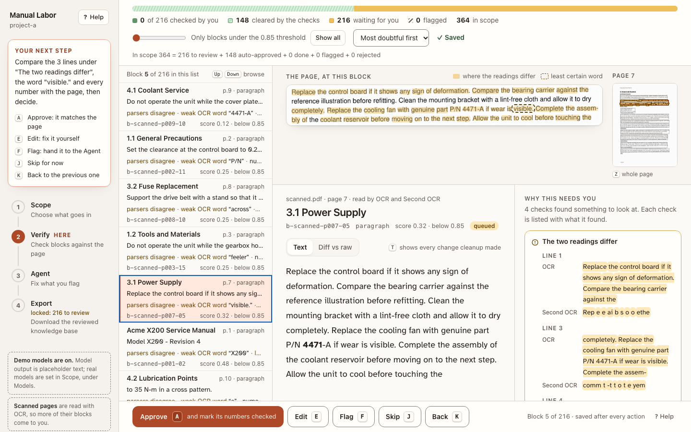
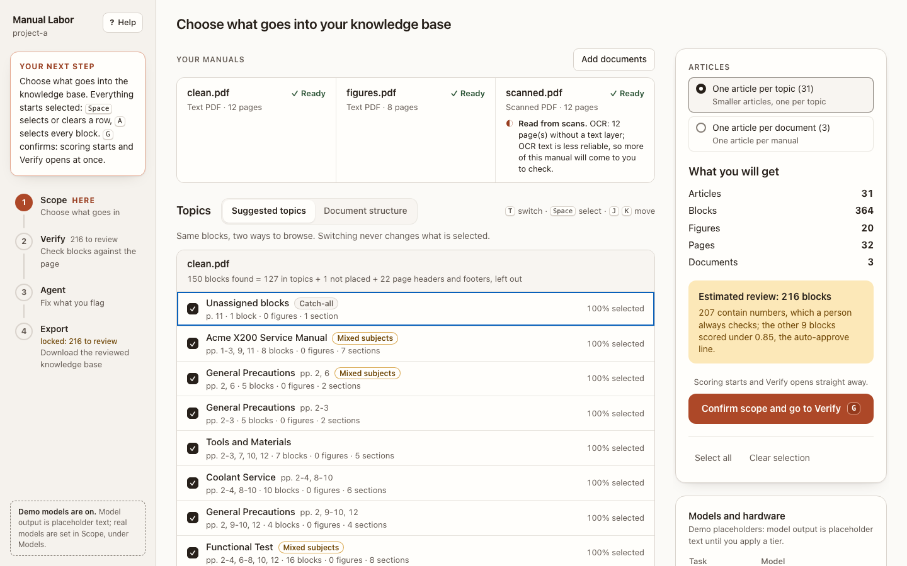
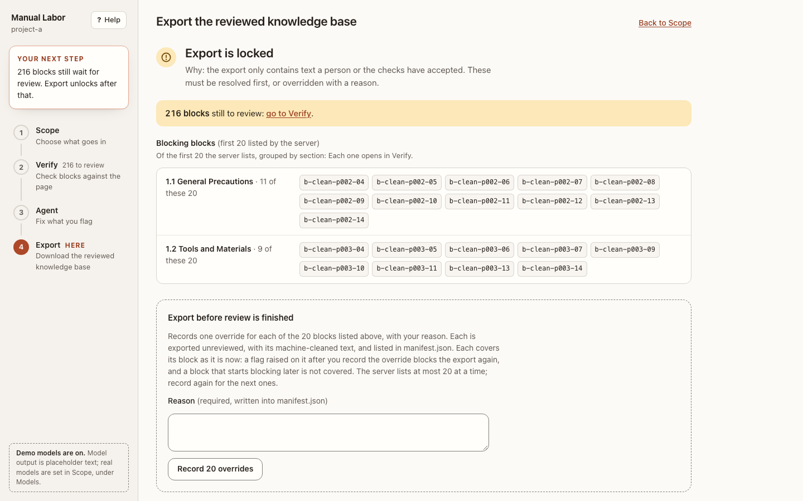

<h1 align="center">Manual Labor</h1>

<p align="center">
  Turn equipment manuals into a reviewed knowledge base an AI can answer from.<br/>
  Deterministic parsing and checks, local models, and a person in the loop only where the machine is unsure.
</p>

<p align="center">
  <a href="https://github.com/ashwinchidambaram/manual-labor/actions/workflows/ci.yml"></a>
  <a href="LICENSE"></a>
  
  
</p>

<p align="center">
  
</p>

## Why

Manuals are where the torque values, part numbers and clearances live, and they arrive as PDFs, scans and Word files. Feeding them to a language model as-is means trusting its reading of every number. Manual Labor does the opposite: everything that can be deterministic is (parsing, IDs, scoring, the faithfulness check, assembly), models are used only for cleanup, topic names, figure descriptions and an optional repair pass, and every model output is re-checked by code before anyone sees it. The reviewer sees only the blocks the checks could not clear, with the evidence beside each decision.

## Features

- **Two parsers and OCR on every page.** PyMuPDF and Docling read every document; the text layer is compared with OCR. Disagreement, not a model's self-reported confidence, decides what needs a person.
- **A faithfulness check that cannot be talked out of.** Cleanup is lossless normalisation. Any other change to characters or numbers fails the check and the block is queued with the diff.
- **Blocks with numbers are always reviewed.** A language model cannot see an OCR mistake in a number, so numeric specs never auto-approve.
- **A guided, keyboard-first review UI.** Four steps, one clear next action, the source page magnified above the text, and every count reconciled on screen. Works at 200 percent zoom and with a screen reader.
- **Figures kept with their captions.** Native extraction, vector art rendered, page crops as a last resort, duplicates detected by perceptual hash, each figure with a JSON sidecar.
- **An agent pass you can audit.** Flagged blocks go to a model with your note; every proposal is re-run through the same checks, and accept is offered only when they all pass.
- **Resumable and reproducible.** Every stage writes to disk, a killed run continues where it stopped, model calls run at temperature 0 and are cached by input hash, and IDs are stable across re-parses.
- **Fully local.** Ollama by default, or API models if you choose. No telemetry, no runtime network calls except to the model provider you configure. API keys are read from the environment only.

## Quick start

```bash
git clone https://github.com/ashwinchidambaram/manual-labor.git
cd manual-labor
uv sync                                  # Python package + the `labor` CLI
(cd frontend && npm ci && npm run build) # the UI, served by `labor serve`
uv run docling-tools models download     # once: layout models for the second parser
```

```bash
uv run labor ingest ./my-project ./manuals/*.pdf        # creates ./my-project
uv run labor probe --apply small --project ./my-project # pick models for this machine
uv run labor run ./my-project                           # parse, score, group (resumable)
uv run labor serve ./my-project                         # http://127.0.0.1:8765
```

The app opens on a welcome that names your manuals and the four steps. Or skip the first and third commands and add manuals through the app's **Add documents** button, which runs the pipeline as a background job.

Check the installation end to end with model calls mocked:

```bash
uv run labor check ./tests/fixtures/project-a
```

## The four steps

| Step | What you do | What the app shows |
|---|---|---|
| **1. Scope** | Choose which blocks go in. Two views of the same blocks (suggested topics, document structure); switching never changes the selection. | Under each document, found = in topics + unplaced + headers and footers left out. |
| **2. Verify** | Approve, edit, flag or skip each block the checks could not clear, most doubtful first. `A` approves, `E` edits, `F` flags, `J` skips. | The source page magnified above the text, the two readings line by line, the least certain word, and a progress bar whose parts add up. |
| **3. Agent** | Hand open flags to a model with your note. Accept, edit or reject each proposal. | Every proposal re-checked by the same code; a failed check is shown, not hidden. Calibration suggests a threshold from your decisions and never applies it for you. |
| **4. Export** | Download the zip and compare its SHA-256. | While locked, exactly which blocks hold it, each with a link. Overrides need a reason and are listed in the manifest. |

<p align="center">
  
  
</p>

Every shortcut and screen is described in the in-app guide and in [docs/USER_GUIDE.md](docs/USER_GUIDE.md).

## What you get

A zip containing:

- `articles/<id>.md`: one Markdown article per topic (or per document) with YAML frontmatter naming the source file, pages, sections, figures and review status.
- `images/<doc>/FIG-<doc>-p###-##.png` (plus `.svg` for vector art) and a JSON sidecar per figure with caption, page, bounding box and extraction method.
- `manifest.json`: every document, article and figure, the review statistics, the models and threshold used, every override with its reason, and an accounting that proves every parsed block ended up in an article or in the unassigned list.
- `README.md` describing the layout.

IDs are stable and greppable: block `b-<doc>-p012-03`, figure `FIG-<doc>-p012-01`. Re-parsing the same bytes reproduces them.

## How it decides what needs you

Signals per block: OCR word confidence (mean and minimum), text layer against OCR, PyMuPDF against Docling (digits weighted three times), reading-order risk, table consistency, garbage ratio, figure extraction method and resolution, the faithfulness check, and an optional verifier model that is required to differ from the cleanup model. The combined score is the minimum of the critical signals times the geometric mean of the rest. At or above the threshold (default 0.85) a block is auto-approved and shown with its evidence; below it, the block waits for you. A block with a numeric spec is queued regardless of score.

Cleanup may only normalise whitespace, join words hyphenated across a line break, remove known headers and footers, normalise bullets, ligatures and Unicode variants, rebuild table layout without changing a cell, and reorder only where another reading confirms the new order. If a sentence reads better after cleanup, that is a bug.

## CLI

| Command | What it does |
|---|---|
| `labor ingest P FILES...` | Create the project if needed, copy sources in and register them. |
| `labor probe [--apply TIER --project P]` | Inspect CPU, RAM, GPU and disk; print model tiers (`small`, `medium`, `large`, `api`) and the `ollama pull` commands; optionally write a tier into `project.json`. Never installs anything. Refuses a tier that does not fit without `--force`. |
| `labor run P [--to STAGE] [--doc SLUG] [--mock]` | Run every stale stage up to `--to` (parse, figures, score, group, clean, score2). Resumable. |
| `labor status P [-v] [--json]` | Per-document stage states: fresh, stale, missing, failed, with the reason. |
| `labor serve P [--port N] [--mock] [--dev]` | API and UI. Exit code 3 means another process holds the project. |
| `labor agent P` | Propose fixes for open flags. Proposals are accepted in the UI, never applied automatically. |
| `labor calibration P [--apply X]` | Suggest a threshold from your decisions. |
| `labor export P [--override REASON]` | Assemble, zip and validate. Exit code 2 while the review gate is locked. |
| `labor validate-export ZIP` | Validate any export against the manifest schema and figure-reference rules. |
| `labor check P [--live]` | End-to-end smoke test on a temporary copy of a project. |

Also `parse`, `figures`, `score`, `group`, `clean`, `assemble`, `learning`, `decisions export`, `schemas export`, `openapi export`. `uv run labor <command> --help` lists every option.

## Configuration

`project.json` is created by `labor ingest` (and by `run` and `export`) with defaults. Keys you are most likely to change:

- `models`: one `{provider, model, api_base, api_key_env}` per task: `cleanup`, `grouping`, `vision`, `embeddings`, `verifier`, and optionally `metadata` and `agent`. Providers: `ollama`, `anthropic`, `openai`, `openai_compatible`, `vllm`, `llamacpp`, `mock`. `labor probe --apply` fills this in; it resets `agent` unless you pass `--keep-overrides`.
- `threshold` (0.85) and `doc_thresholds` to pin a value per document.
- `cleanup.llm`: `off`, `residual` (model only where the rules left something) or `always`.
- `ocr_engine` (`auto` uses Tesseract when it is on `PATH`, otherwise the bundled RapidOCR) and `ocr_dpi` (300 minimum).
- `learning.enabled`: whether your edits become rules for later blocks. Every rule is shown on the block it touched and can be disabled or reset.

Environment: `ANTHROPIC_API_KEY`, `OPENAI_API_KEY`, `OPENAI_BASE_URL`, `OLLAMA_HOST` (default `http://localhost:11434`), `MANUALLABOR_OFFLINE=1` to block every network call except the Ollama host, `MANUALLABOR_DOCLING_ARTIFACTS` for a Docling model directory elsewhere, `MANUALLABOR_HOME` for the global learning store (default `~/.manuallabor`).

## Inside a project folder

```
my-project/
  project.json        models, threshold, parsers, OCR settings (the only file you edit by hand)
  sources/            byte copies of what you ingested
  docs/<slug>/        per-document outputs: blocks.json, scores.json, groups.json, clean.json, pages/
  figures/<slug>/     FIG-*.png|svg + one JSON sidecar each; figures/index.json
  project.db          SQLite: every decision, flag, proposal, selection and job
  selection.json, agent/   human-readable copies of DB tables; the DB is the source of truth
  logs/jobs/          one NDJSON progress log per background job
  llm_calls.jsonl     one line per model call: task, model, tokens, latency, input hash, cached
  .llm_cache/         model responses keyed by input hash, so re-runs reuse them
  learning/           learned rules and calibration, with snapshots you can roll back
  export/             assembled/ staging tree, state.json, and the zip
```

Scores are an overlay. `blocks.json`, the raw parse, is never touched by later stages; only a re-parse rewrites it, and `labor run` refuses to re-parse a document with recorded decisions unless you pass `--discard-decisions`.

## Requirements

- macOS or Linux, Python 3.12 (managed by `uv`), Node 22 to build the UI.
- About 16 GB of RAM for the `small` local tier (`llama3.2:1b`, `qwen2.5:1.5b`, `moondream`, `nomic-embed-text`). `medium` and `large` need more; `api` needs both `ANTHROPIC_API_KEY` (chat, vision, verifier) and `OPENAI_API_KEY` (embeddings).
- [Ollama](https://ollama.com) for local models. `labor probe` prints the exact `ollama pull` commands for a tier.
- Docling layout models, downloaded once with `uv run docling-tools models download`. The parser never downloads at runtime.
- Tesseract is optional; RapidOCR is bundled.

A 200-page born-digital manual parses and scores in a few minutes on a laptop without a GPU. The model steps take longer and run as background jobs while you review.

## Troubleshooting

- **"frontend not built"** at the root URL: run `npm run build` in `frontend/`, or point `MANUALLABOR_FRONTEND_DIST` at a built copy.
- **`labor serve` exits with code 3**: another `labor` process holds the project (`.labor.lock`). Stop it first.
- **Parse fails with "docling models not cached"**: run `uv run docling-tools models download` once, or set `MANUALLABOR_DOCLING_ARTIFACTS`. Set `MANUALLABOR_ALLOW_MODEL_DOWNLOAD=1` only if you want a one-time runtime download.
- **A manual says "Not run yet"**: it was ingested from the CLI and the pipeline has not run. Press Run on the Scope screen, or stop `serve` and run `labor run`.
- **A stage shows stale**: the source file, the threshold or a learning layer changed since it ran. `labor run` recomputes only what is stale; `labor status -v` names the reason.
- **The agent pass proposes nothing usable**: the 1B local model cannot follow the proposal schema. Set `models.agent` in `project.json` to a 7B-class model (for example `qwen2.5:7b`) or an API model.

## Development

```bash
uv run pytest                                   # unit + contract tests (slow Docling/OCR tests deselected by default)
uv run ruff check manuallabor/ tests/ && uv run ruff format --check manuallabor/ tests/
uv run mypy manuallabor/                        # strict
cd frontend && npm test -- --run                # vitest
npx playwright install chromium                 # once
npm run e2e                                     # Playwright; builds a fixture project (needs the Docling models) and ports 5173, 8765, 8766
```

Contracts are code: change a Pydantic model in `manuallabor/contracts/`, then regenerate the JSON schemas, the OpenAPI document and the TypeScript types so both sides move together. [CLAUDE.md](CLAUDE.md) has the exact commands and the change process; [docs/ARCHITECTURE.md](docs/ARCHITECTURE.md) is the code map.

Issues and pull requests are welcome. Keep the faithfulness tests green: if a model-based change makes one fail, constrain the model output rather than loosening the test.

## Documentation

- [SPEC.md](SPEC.md): what the product must do, and the acceptance criteria.
- [docs/USER_GUIDE.md](docs/USER_GUIDE.md): the in-app guide, glossary and every shortcut.
- [docs/ARCHITECTURE.md](docs/ARCHITECTURE.md): the code map for anyone changing it.
- [docs/design/](docs/design/): one design document per module, with the decisions and their reasons.
- [docs/PROGRESS.md](docs/PROGRESS.md) and [docs/ACCEPTANCE.md](docs/ACCEPTANCE.md): the gate each module passed, with the command output that proved it.
- [PRODUCT.md](PRODUCT.md) and [DESIGN.md](DESIGN.md): the product principles and the design system the UI follows.

## License

MIT, see [LICENSE](LICENSE). The bundled Atkinson Hyperlegible font is under the SIL Open Font License (see `frontend/src/assets/fonts`).
